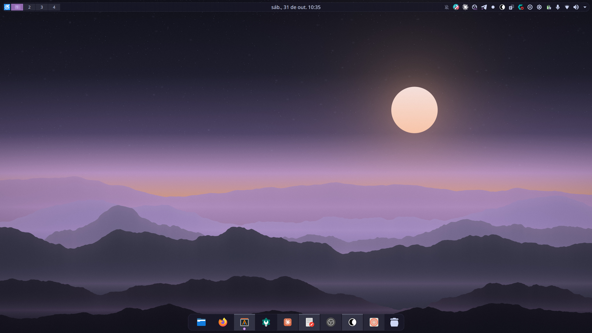

# Dotfiles


Meus arquivos de configuração do Linux, separados por "época" do meu sistema.
Hoje uso **CachyOS + KDE Plasma 6**. As configurações antigas de **i3** e **Hyprland** (da época do Linux Mint) continuam aqui.

<div align="center">
  
</div>

## Qual usar?

| Pasta | O que é | Como instalar | Como desfazer |
|---|---|---|---|
| [`kde/mocha`](kde/mocha) | **Visual atual.** KDE Plasma 6 com Catppuccin Mocha: vidro fosco, cantos arredondados, barra no topo e dock, lançador Vicinae | `./install.sh` | `./voltar.sh` |
| [`kde/otto-lain`](kde/otto-lain) | **Visual anterior do KDE.** Tema Otto, decoração MoeDark, Plasma Orchis-dark, ícones kora, cursor Volantes, splash Lain | `./instalar.sh` | `./voltar.sh` |
| [`tiling`](tiling) | i3 (X11) e Hyprland (Wayland) com hyprlock, hyprpaper e waybar | GNU Stow | `stow -D` |
| [`terminal`](terminal) | bash, Kitty e Warp | GNU Stow / cópia | `stow -D` |
| [`editor`](editor) | Neovim (config própria) e NvChad | GNU Stow / clone | apagar a pasta |

As duas versões do KDE são independentes: dá para trocar de uma para a outra quando quiser,
e as duas fazem um backup do visual atual antes de mudar qualquer coisa.

```bash
git clone https://github.com/MarcusMix/dotfiles ~/dotfiles
cd ~/dotfiles
```

---

## KDE Plasma 6

Requisitos: KDE Plasma 6 (testado no CachyOS, Plasma 6.8, Wayland, 1920×1080), `git` e `curl`.
Nada é instalado com `sudo`, exceto os dois pacotes opcionais do Mocha (`kvantum` e `kwin-effect-rounded-corners`).

### Mocha (atual)

```bash
cd ~/dotfiles/kde/mocha
./install.sh               # instala tudo (pede a senha uma vez para 2 pacotes)
./install.sh --sem-sudo    # sem pedir senha (fica sem Kvantum e sem cantos arredondados)
./install.sh --lista       # mostra as partes (módulos)
./install.sh --so 20 85    # instala só algumas partes (aqui: cores e terminal)
./voltar.sh                # volta ao visual de antes
```

As escolhas (sabor do Catppuccin, cor de destaque, fontes, apps da dock, atalho do lançador, animações) ficam em
[`kde/mocha/rice.conf`](kde/mocha/rice.conf). Mude e rode `./install.sh` de novo.
Detalhes, atalhos e problemas comuns: [`kde/mocha/README.md`](kde/mocha/README.md).

### Otto + Lain (anterior)

```bash
cd ~/dotfiles/kde/otto-lain
./instalar.sh              # instala temas + configurações (com backup antes)
./instalar.sh --so-temas   # só copia os temas; você escolhe em Configurações › Aparência
./voltar.sh                # volta ao visual de antes
```

Detalhes: [`kde/otto-lain/README.md`](kde/otto-lain/README.md).

### Trocar de uma versão para a outra

Basta rodar o instalador da outra. Exemplo, do Mocha para o Otto + Lain:

```bash
~/dotfiles/kde/otto-lain/instalar.sh
```

O `voltar.sh` (de qualquer uma das duas) sempre volta ao **último backup**, ou seja, ao visual que estava
antes do último instalador que você rodou. Os backups ficam em `~/kde-backup-AAAA-MM-DD_HHMMSS/` e cada um
tem um `restaurar.sh` próprio. Para voltar a um backup mais antigo:

```bash
~/dotfiles/kde/mocha/voltar.sh ~/kde-backup-2026-10-31_103000
```

Depois de trocar, **saia e entre de novo na sessão** para ver a tela de inicialização e as fontes em todos os apps.

---

## Configs com GNU Stow (i3, Hyprland, terminal, Neovim)

Essas pastas seguem o formato do [GNU Stow](https://www.gnu.org/software/stow/): cada pasta tem a estrutura
de dentro da sua home (`i3/.config/i3/config` vai para `~/.config/i3/config`). O Stow cria links simbólicos,
então editar o arquivo na home edita o do repositório.

```bash
sudo pacman -S stow        # Arch/CachyOS  (Debian/Mint: sudo apt install stow)

cd ~/dotfiles/tiling
stow -t ~ hyprland hyprlock hyprmocha hyprpaper waybar   # Hyprland completo
stow -t ~ i3                                             # i3

cd ~/dotfiles/terminal
stow -t ~ kitty bash

cd ~/dotfiles/editor
stow -t ~ nvim

stow -D -t ~ kitty         # desfaz (remove os links)
```

> Se já existir um arquivo no lugar, o Stow para e avisa. Faça backup e apague o seu antes
> (`mv ~/.config/kitty ~/.config/kitty.bak`).

### `tiling/` — gerenciadores de janelas

| Pacote | Vai para | Precisa de |
|---|---|---|
| `hyprland` | `~/.config/hypr/hyprland.conf` | hyprland, kitty, nautilus, waybar, swaync, hyprpaper, hyprshot |
| `hyprlock` | `~/.config/hypr/hyprlock.conf` | hyprlock |
| `hyprmocha` | `~/.config/hypr/mocha.conf` (cores Catppuccin Mocha) | — |
| `hyprpaper` | `~/.config/hypr/hyprpaper.conf` | hyprpaper |
| `waybar` | `~/.config/waybar/config` | waybar |
| `i3` | `~/.config/i3/config` | i3, polybar, picom, feh, flameshot, warp-terminal |

O i3 chama `~/.config/polybar/launch_polybar.sh`, `~/.config/picom.conf` e o wallpaper
`~/.config/backgrounds/sunset-green.jpg`, que **não estão** neste repositório: crie os seus ou comente essas linhas.

<details>
<summary>Atalhos do Hyprland</summary>

| Atalho | Ação |
|---|---|
| `Super + Enter` | terminal (kitty) |
| `Super + E` | arquivos (nautilus) |
| `Super + Q` | fecha a janela |
| `Super + V` | janela flutuante |
| `Super + H/J/K/L` | muda o foco |
| `Super + 1-0` | área de trabalho |
| `Super + Shift + 1-0` | move a janela para a área |
| `Super + Shift + L` | bloqueia a tela (hyprlock) |
| `Print` / `Shift + Print` | print da janela / de uma região |
| `Super + M` | sai do Hyprland |

</details>

<details>
<summary>Atalhos do i3</summary>

| Atalho | Ação |
|---|---|
| `Super + Enter` | terminal (Warp) |
| `Super + F` | Firefox |
| `Super + Q` | fecha a janela |
| `Super + 1-9` | área de trabalho |
| `Super + Shift + 1-9` | move a janela para a área |
| `Super + Shift + Q` | sai do i3 (pede confirmação) |

</details>

### `terminal/`

| Pacote | Vai para | Observação |
|---|---|---|
| `kitty` | `~/.config/kitty/` | `kitty.conf` + tema `type_theme.conf` |
| `bash` | `~/.config/bash/.bashrc` | carregue no seu `~/.bashrc` com `source ~/.config/bash/.bashrc` |
| `warp-terminal` | — | não é pacote do Stow: copie `user_preferences.json` para `~/.config/warp-terminal/` |

O Alacritty, o fish, o Starship, o fastfetch e o btop do KDE Mocha ficam em [`kde/mocha/config`](kde/mocha/config)
e são instalados pelo `install.sh` de lá.

### `editor/`

- **`nvim`** — config própria do Neovim (lazy.nvim, LSP, Neo-tree, none-ls, Telescope, Treesitter):
  `cd ~/dotfiles/editor && stow -t ~ nvim`.
- **`nvchad`** — config do [NvChad](https://nvchad.com). Não é pacote do Stow: copie a pasta para onde o Neovim lê a config.
  ```bash
  mv ~/.config/nvim ~/.config/nvim.bak
  cp -r ~/dotfiles/editor/nvchad ~/.config/nvim
  nvim                 # na primeira vez o lazy.nvim baixa os plugins
  ```
  Com o Neovim do Flatpak, a pasta é `~/.var/app/io.neovim.nvim/config/nvim`
  (veja [`editor/nvchad/README.md`](editor/nvchad/README.md)).

> Não use `nvim` e `nvchad` ao mesmo tempo: os dois são `~/.config/nvim`.

---

## Como está organizado

```
dotfiles/
├── kde/
│   ├── mocha/          visual atual do KDE (Catppuccin Mocha) — install.sh / voltar.sh / backup.sh
│   └── otto-lain/      visual anterior do KDE (Otto + Lain)   — instalar.sh / voltar.sh
├── tiling/             i3, hyprland, hyprlock, hyprmocha, hyprpaper, waybar   (Stow)
├── terminal/           bash, kitty, warp-terminal                             (Stow)
└── editor/             nvim (Stow), nvchad (cópia)
```

## Licença

O código e as configurações deste repositório são [MIT](LICENSE). Os temas de terceiros incluídos em
`kde/otto-lain/temas` mantêm as licenças dos autores (veja o README da pasta); os do Mocha são baixados
dos projetos originais na instalação.

<div align="center">
  <p>Feito por <a href="https://github.com/MarcusMix">MarcusMix</a></p>
</div>
