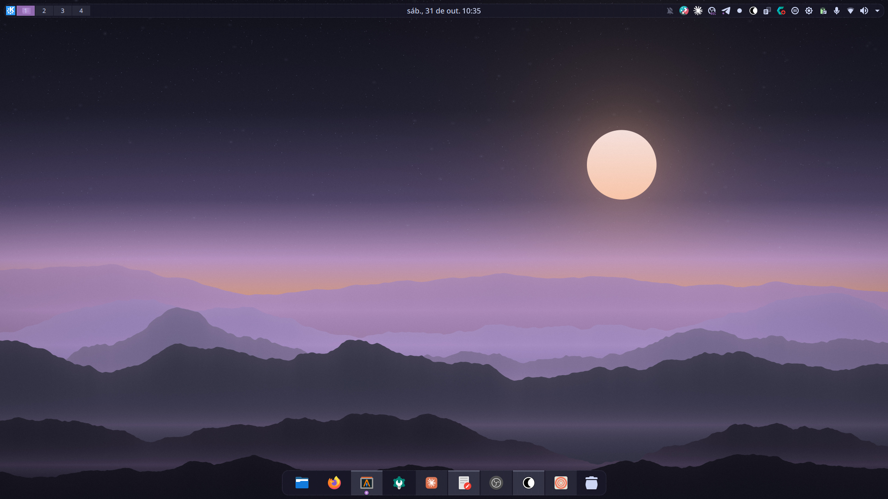
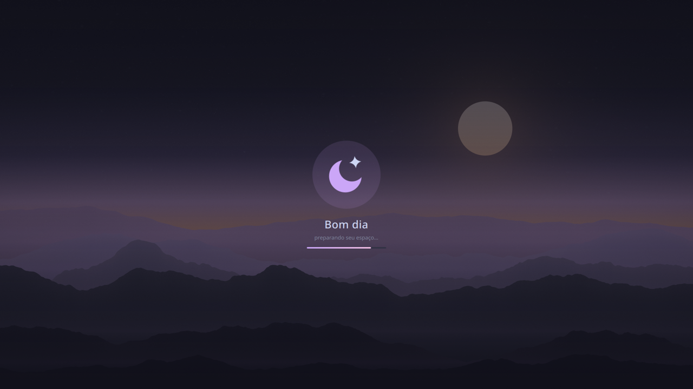
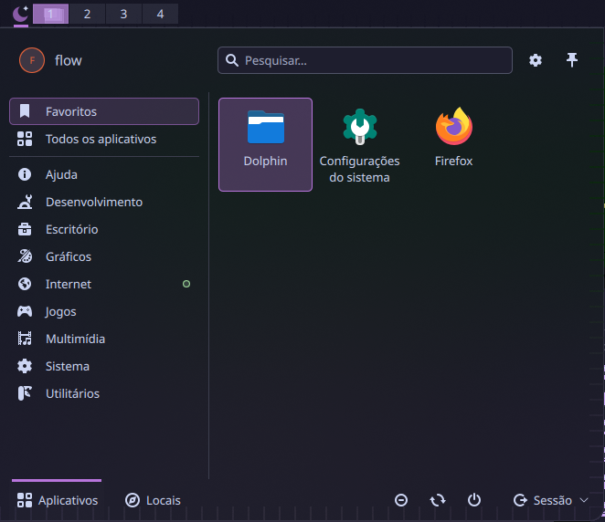

# ☾ kde-mocha-rice

> Parte dos meus [dotfiles](../../README.md). A versão anterior do meu KDE está em [`../otto-lain`](../otto-lain).

Um rice completo para o **KDE Plasma 6** na paleta [Catppuccin](https://catppuccin.com) **Mocha**:
vidro fosco, cantos arredondados, animações suaves, lançador estilo Raycast e um terminal bonito.
É **um comando para instalar** e **um comando para voltar** ao que você tinha antes.



| Tela de inicialização | Menu |
|---|---|
|  |  |

---

## Instalar

```bash
git clone https://github.com/MarcusMix/dotfiles ~/dotfiles
cd ~/dotfiles/kde/mocha
./install.sh
```

Pronto. O instalador:

1. **faz um backup do seu visual atual** em `~/kde-backup-DATA/` (com um `restaurar.sh` dentro);
2. pede sua senha **uma única vez** para instalar 2 pacotes do sistema (`kvantum` e `kwin-effect-rounded-corners`);
3. baixa e aplica todo o resto **no seu usuário**, sem sudo.

Depois, **saia e entre de novo na sessão** para ver a tela de inicialização e para todos os apps pegarem as fontes novas.

> Não quer digitar senha? `./install.sh --sem-sudo` instala tudo menos o Kvantum e os cantos arredondados.

## Voltar ao visual anterior

```bash
./voltar.sh
```

Ele usa o backup que o `install.sh` fez. Também dá para escolher um backup específico:
`./voltar.sh ~/kde-backup-2026-10-31_103000`. E dá para fazer um backup a qualquer hora com `./backup.sh`.

---

## O que vem no rice

| Parte | O que é | Módulo |
|---|---|---|
| **Cores** | Esquema Catppuccin Mocha com destaque malva (`CatppuccinMochaMauve`) | `20-cores` |
| **Estilo dos aplicativos** | [Kvantum](https://github.com/tsujan/Kvantum) com o tema Catppuccin; GTK escuro acompanhando | `20-cores` |
| **Estilo do Plasma** | **Mocha Glass** (feito para este rice): painéis e popups de vidro fosco, cantos de 14–16 px, contorno de 1 px; as cores vêm do esquema ativo | `30-plasma-estilo` |
| **Ícones** | [Papirus-Dark](https://github.com/PapirusDevelopmentTeam/papirus-icon-theme) com pastas na cor de destaque ([catppuccin/papirus-folders](https://github.com/catppuccin/papirus-folders)) | `40-icones-cursor` |
| **Ponteiro do mouse** | [Catppuccin Cursors](https://github.com/catppuccin/cursors) Mocha Mauve | `40-icones-cursor` |
| **Fontes** | [Inter](https://rsms.me/inter/) na interface, [JetBrains Mono Nerd Font](https://www.nerdfonts.com/) no terminal; suavização com subpixel | `10-fontes` |
| **Decoração das janelas** | Catppuccin **Modern** (botões redondos), sem bordas | `50-janelas-animacoes` |
| **Cantos arredondados** | [KDE-Rounded-Corners](https://github.com/matinlotfali/KDE-Rounded-Corners): 12 px e contorno fino na cor de destaque | `50-janelas-animacoes` |
| **Animações** | Abrir/fechar com **Aura Glow** ([Burn My Windows](https://github.com/Schneegans/Burn-My-Windows)), minimizar com lâmpada mágica, desfoque forte, troca de área de trabalho deslizando | `50-janelas-animacoes` |
| **Taskbar** | Barra fina flutuante no topo (menu com ícone de lua, 4 áreas de trabalho, relógio com data no centro, bandeja) + **dock** flutuante embaixo, centralizada, que fica escondida e aparece quando o mouse encosta na borda de baixo | `60-painel` |
| **Tela de inicialização** | Splash próprio: wallpaper desfocado, lua que pulsa, saudação pela hora ("Boa noite"), barra de progresso em degradê | `70-splash` |
| **Sons do sistema** | Tema **Ocean** do KDE (suave, feito com instrumentos reais) + som ao mudar o volume | `75-sons` |
| **Wallpapers** | 3 originais em 4K, gerados em código na paleta Mocha: montanhas com lua (área de trabalho), aurora sobre lago (bloqueio), ondas | `80-wallpaper` |
| **Terminal** | Alacritty transparente com desfoque, padding, cursor em barra piscando; perfil igual no Konsole | `85-terminal` |
| **Prompt** | [Starship](https://starship.rs) com o preset `catppuccin-powerline`; cores Catppuccin no fish | `85-terminal` |
| **Extras do terminal** | fastfetch com ícones e cores do tema; btop com tema Catppuccin | `85-terminal` |
| **Lançador estilo Raycast** | [Vicinae](https://github.com/vicinaehq/vicinae) no **Meta+Espaço**: apps, calculadora, área de transferência, emojis, arquivos, comandos e extensões | `90-lancador` |

### Atalhos

| Atalho | Faz |
|---|---|
| `Meta+Espaço` | abre o lançador Vicinae |
| `Meta` | abre o menu de aplicativos |
| `Meta+W` | visão geral das janelas e áreas de trabalho |
| `Meta+Ctrl+←/→` | troca de área de trabalho |
| `Ctrl+Shift+N` (no Alacritty) | nova janela do terminal |

---

## Personalizar

Tudo o que dá para escolher está em **[`rice.conf`](rice.conf)**. Mude e rode `./install.sh` de novo.

```bash
FLAVOR="mocha"          # mocha, macchiato, frappe ou latte (claro)
ACCENT="mauve"          # rosewater flamingo pink mauve red maroon peach yellow
                        # green teal sky sapphire blue lavender
WALLPAPER="mocha-montanhas.jpg"
EFEITO_JANELA="kwin6_effect_aura_glow"   # ou wisps, glide, portal, tv, fire...
JANELAS_GELATINA="false"                 # true = janelas "gelatina" ao arrastar
DOCK_APPS="org.kde.dolphin.desktop,firefox.desktop,Alacritty.desktop"
ATALHO_LANCADOR="Meta+Space"
VELOCIDADE_ANIMACAO=0.7                  # menor = mais rápido
```

Para mudar só uma parte, rode só o módulo dela:

```bash
./install.sh --lista          # mostra os módulos
./install.sh --so 50          # só janelas e animações
./install.sh --so 20 40 85    # cores, ícones e terminal
```

### Gerar os wallpapers de novo (ou em outra resolução)

```bash
pip install numpy pillow
python3 ferramentas/gerar_wallpapers.py assets/wallpapers 3840 2160
```

Os wallpapers são desenhados em código (montanhas com ruído fractal, aurora, ondas). Mude as cores ou as
sementes (`default_rng(7)`) no script para ter variações.

### Mudar o estilo do Plasma

O Mocha Glass é gerado por `ferramentas/gerar_plasma_style.py`: raio dos cantos, transparência e contorno
ficam no fim do arquivo. Rode o script e depois `./install.sh --so 30`.

---

## Como está organizado

```
kde/mocha/
├── install.sh            instala (faz backup antes)
├── voltar.sh             volta ao visual anterior
├── backup.sh             salva o visual atual + cria restaurar.sh
├── rice.conf             SUAS ESCOLHAS (sabor, destaque, fontes, apps da dock...)
├── lib/comum.sh          funções compartilhadas (download com cache, kwriteconfig, mensagens)
├── modulos/              um script por parte do visual, rodados em ordem
│   ├── 00-pacotes.sh         kvantum + cantos arredondados (único que usa sudo)
│   ├── 10-fontes.sh          Inter + JetBrains Mono Nerd Font
│   ├── 20-cores.sh           esquema Catppuccin, Kvantum, GTK
│   ├── 30-plasma-estilo.sh   Mocha Glass
│   ├── 40-icones-cursor.sh   Papirus + pastas Catppuccin + cursor
│   ├── 50-janelas-animacoes.sh  decoração, efeitos, cantos, áreas de trabalho
│   ├── 60-painel.sh          barra do topo + dock (usa config/plasma/painel.js)
│   ├── 70-splash.sh          tela de inicialização
│   ├── 75-sons.sh            tema de sons Ocean
│   ├── 80-wallpaper.sh       wallpaper + tela de bloqueio
│   ├── 85-terminal.sh        Alacritty, Konsole, Starship, fish, fastfetch, btop
│   └── 90-lancador.sh        Vicinae + atalho Meta+Espaço
├── config/               arquivos copiados para ~/.config (alacritty, fish, fastfetch, painel.js)
├── assets/
│   ├── wallpapers/       os 3 wallpapers 4K
│   ├── plasma-style/     o estilo Mocha Glass
│   ├── splash/           a tela de inicialização (QML)
│   ├── icones/           ícone de lua do menu
│   └── preview/          prints deste README
└── ferramentas/          geradores dos wallpapers e do estilo do Plasma
```

**Onde as coisas vão parar** (tudo no seu usuário):
`~/.local/share/{color-schemes,icons,aurorae,plasma,kwin/effects,sounds,wallpapers,fonts}`,
`~/.config/{Kvantum,alacritty,fastfetch,btop,vicinae,starship.toml}`, `~/.local/bin/{vicinae,starship,papirus-folders}`.
Os downloads ficam em cache em `~/.cache/kde-mocha-rice` (pode apagar quando quiser).

---

## Problemas comuns

- **Os apps continuam com o visual antigo** → feche e abra de novo, ou saia e entre na sessão.
- **Sem cantos arredondados / apps sem Kvantum** → faltam os pacotes do sistema: `./install.sh --so 00 20 50`.
  Fora do Arch/CachyOS, instale `kvantum` e `kwin-effect-rounded-corners` pelo gerenciador da sua distro.
- **Meta+Espaço não abre nada** → veja se o servidor está de pé: `vicinae ping`. Se não, `vicinae server &`.
  O atalho pode ser trocado em *Configurações › Atalhos* (procure "Vicinae").
- **A animação de abrir janelas é demais** → `EFEITO_JANELA="glide"` no `rice.conf` e `./install.sh --so 50`.
- **Quero os painéis do meu jeito** → `PAINEL="nao"` no `rice.conf` (o rice não mexe nos painéis).
- **Algo deu errado** → `./voltar.sh` e tudo volta.

## Testado em

CachyOS · KDE Plasma 6.8 · Wayland · 1920×1080. Deve funcionar em qualquer distro com Plasma 6.

## Créditos e licenças

O código deste repositório (scripts, estilo Mocha Glass, splash, wallpapers e ícone) é **MIT** — use e modifique à vontade.
Os temas de terceiros são baixados direto dos projetos originais na instalação e seguem as licenças deles:
[Catppuccin](https://github.com/catppuccin) (KDE, Kvantum, cursores, Alacritty, Konsole, btop, papirus-folders — MIT),
[Papirus](https://github.com/PapirusDevelopmentTeam/papirus-icon-theme) (GPL-3.0),
[Burn My Windows](https://github.com/Schneegans/Burn-My-Windows) (GPL-3.0),
[Inter](https://github.com/rsms/inter) e [JetBrains Mono](https://github.com/JetBrains/JetBrainsMono) (OFL),
[Vicinae](https://github.com/vicinaehq/vicinae) (GPL-3.0), [Starship](https://github.com/starship/starship) (ISC),
tema de sons [Ocean](https://invent.kde.org/plasma/ocean-sound-theme) (KDE, CC BY-SA 4.0).
